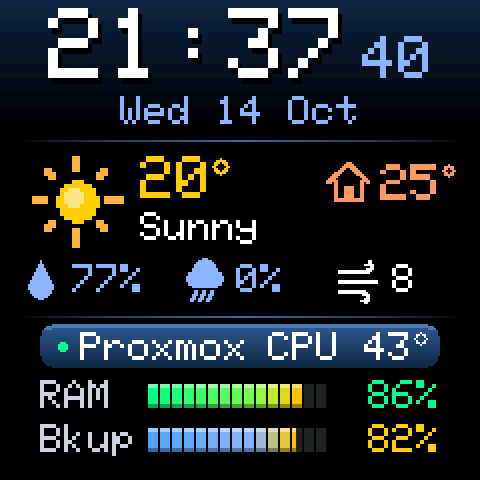
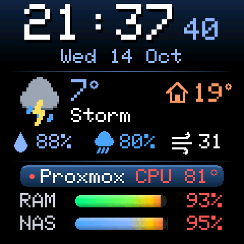
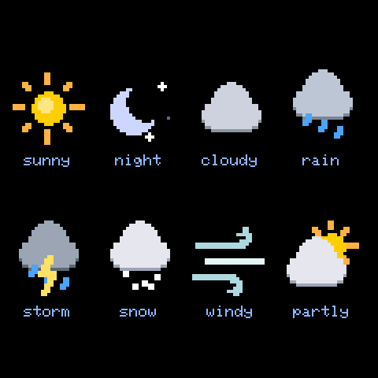
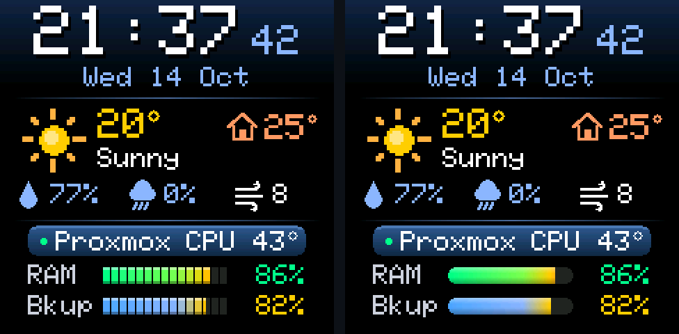
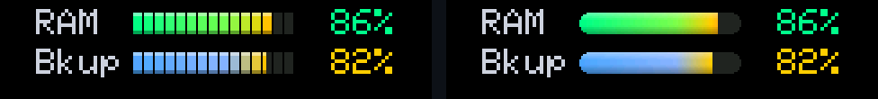
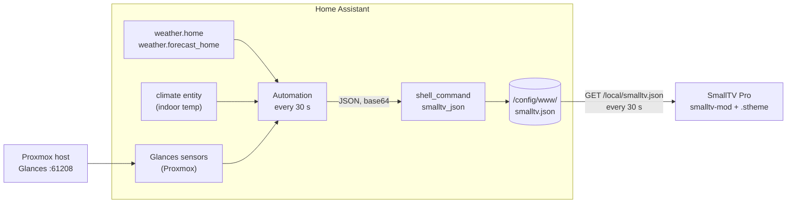
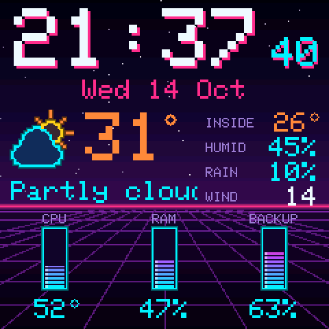
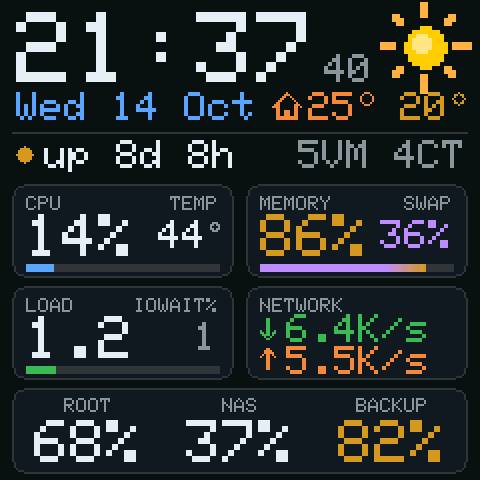

<p align="center">
  
</p>

<h1 align="center">SmallTV Home Assistant Dashboard</h1>

<p align="center">
  Clock faces for the <b>GeekMagic SmallTV Pro</b> running <a href="https://github.com/giovi321/smalltv-mod">smalltv-mod</a>,<br/>
  fed by <b>Home Assistant</b>: time, weather, indoor temperature and <b>Proxmox</b> server health on a 240×240 screen.
</p>

---

## Contents

- [What it shows](#what-it-shows)
- [Two bar styles](#two-bar-styles)
- [How it works](#how-it-works)
- [Requirements](#requirements)
- [Setup](#setup)
  - [1. Let Home Assistant write a JSON file](#1-let-home-assistant-write-a-json-file)
  - [2. Add the automation](#2-add-the-automation)
  - [3. Check the JSON](#3-check-the-json)
  - [4. Install the theme on the TV](#4-install-the-theme-on-the-tv)
- [The JSON the TV reads](#the-json-the-tv-reads)
- [Adapting it to your setup](#adapting-it-to-your-setup)
- [How the theme is built (the tricks)](#how-the-theme-is-built-the-tricks)
- [Extra themes: Neon and Glance](#extra-themes-neon-and-glance)
- [Rebuilding the themes](#rebuilding-the-themes)
- [Troubleshooting](#troubleshooting)
- [Version history](#version-history)
- [Credits](#credits)

---

## What it shows

<p align="center">
  
  &nbsp;
  
</p>

| Area | What you see | Where it comes from |
| --- | --- | --- |
| **Clock** | `HH:MM` with running seconds and the date | The TV's own clock (NTP) |
| **Weather** | Animated icon, outdoor temperature, condition | `weather.home` |
| **Home** | Indoor temperature next to a house icon | A climate entity's `current_temperature` |
| **Details** | Humidity, chance of rain, wind | `weather.forecast_home`, a rain-probability sensor, the daily forecast |
| **Proxmox** | CPU package temperature with a status dot, RAM and backup-disk usage bars | Glances sensors in Home Assistant |

Everything reacts to the data:

- **Temperature color:** the outdoor temperature shifts from blue (cold) through cyan, yellow and orange to red (33° and up).
- **Rain warning:** when rain is likely (50% or more), the rain icon and its percentage turn a stronger blue.
- **CPU:** the reading turns red above 75°C, and the status dot switches from a slow green pulse to a faster red one.
- **Bars and percentages:** RAM turns red above 90%. Backup turns yellow above 80% and red above 90%.

### Animated weather icons

<p align="center">
  
</p>

Eight conditions, each a small looping animation:
- **Sunny:** a sun that sways gently.
- **Night:** a moon with twinkling stars.
- **Cloudy:** a drifting cloud.
- **Rain:** falling drops.
- **Storm:** rain with an occasional lightning flash.
- **Snow:** falling flakes.
- **Windy:** swaying gusts.
- **Partly cloudy:** a cloud drifting in front of the sun.

The animations are deliberately slow (2–4 frames per second) so they don't pull your eye all day.

---

## Two bar styles

The same dashboard comes in two variants. They have different theme IDs, so you can install both and switch on the TV.

<p align="center">
  
</p>

<p align="center">
  
</p>

| File | Theme name | Bars |
| --- | --- | --- |
| [`ha-dashboard/ha-dashboard.stheme`](ha-dashboard/ha-dashboard.stheme) | HA Dashboard | 15 retro segments with a glossy top edge |
| [`ha-dashboard/ha-dashboard-smooth.stheme`](ha-dashboard/ha-dashboard-smooth.stheme) | HA Dashboard Smooth | Rounded pill with a continuous gradient |

---

## How it works

A smalltv-mod theme can poll JSON over HTTP, but it **can't send an `Authorization` header**, so it can't call Home Assistant's API directly. Instead, Home Assistant writes a small JSON file into its `www` folder, which it serves **without login** at `/local/`. The TV polls that file every 30 seconds.



Why it's split up this way:
- **The automation does all the formatting.** Rounding, names and fallbacks happen in Jinja, so the TV only receives ready-to-print strings. The theme format can't round numbers or map a weather state to a name by itself.
- **The payload goes to the shell command base64-encoded**, so no quote or special character in a value can break the command.
- **The time comes from the TV itself**, so the clock and seconds keep running even if Home Assistant is down. Data fields then show `--` until the next successful fetch.

---

## Requirements

- A GeekMagic SmallTV (Pro) flashed with **[smalltv-mod](https://github.com/giovi321/smalltv-mod)**, which installs `.stheme` packages.
- **Home Assistant**. Tested on the Docker container (`ghcr.io/home-assistant/home-assistant:stable`, host networking); HA OS works the same way.
- For the Proxmox section: the **[Glances integration](https://www.home-assistant.io/integrations/glances/)** in Home Assistant, pointed at Glances running on the Proxmox host.
- A `weather.*` entity (for example **Met.no**) and, optionally, a climate or temperature entity for indoors.

---

## Setup

### 1. Let Home Assistant write a JSON file

**a. Create the `www` folder** inside your Home Assistant config folder.

```bash
# Docker: on the host, using the folder you mount to /config
sudo mkdir -p /var/lib/homeassistant/config/www
```

On HA OS, use the File editor or Studio Code Server add-on and create a `www` folder in `/config`.

**b. Add the shell command** from [`home-assistant/configuration.yaml`](home-assistant/configuration.yaml) to your `configuration.yaml`:

```yaml
shell_command:
  smalltv_json: >-
    python3 -c "import sys,base64;open('/config/www/smalltv.json','wb').write(base64.b64decode(sys.argv[1]))" {{ data }}
```

> If you already have a `shell_command:` section, add only the `smalltv_json` entry under it. Two `shell_command:` keys break the config.

On Docker you can append it straight from the host:

```bash
sudo tee -a /var/lib/homeassistant/config/configuration.yaml > /dev/null <<'EOF'

shell_command:
  smalltv_json: >-
    python3 -c "import sys,base64;open('/config/www/smalltv.json','wb').write(base64.b64decode(sys.argv[1]))" {{ data }}
EOF
```

**c. Check the configuration, then restart Home Assistant.** Go to **Developer tools → YAML → Check configuration**, then **Settings → System → Restart**, or run `docker restart homeassistant`. The `www` folder and the shell command only load after a full restart.

### 2. Add the automation

1. Go to **Settings → Automations & scenes → Create automation → Create new automation**.
2. Open **⋮ → Edit in YAML**, replace everything with [`home-assistant/automation.yaml`](home-assistant/automation.yaml), and **Save**.
3. Change the entity IDs to yours (see [Adapting it to your setup](#adapting-it-to-your-setup)).

The automation runs every 30 seconds and at startup. It:
1. Fetches the daily forecast.
2. Builds the payload in one `variables` step.
3. Hands it to `shell_command.smalltv_json`.

### 3. Check the JSON

Run the automation once (**⋮ → Run actions**), then open:

```
http://<home-assistant-ip>:8123/local/smalltv.json
```

You should see something like:

```json
{"wx":{"t":"20","h":"25","c":"Sunny","hu":"77%","pp":"0%","pph":0,"w":"8","wi":0},
 "pve":{"cpu":43,"ram":86,"bk":82,"tl":2,"hl":2}}
```

### 4. Install the theme on the TV

> **Set your Home Assistant address first.** The packages in this repo poll the placeholder `http://YOUR-HA-IP:8123/local/smalltv.json`, which won't resolve until you change it. Either rebuild with `DATA_URL=http://<your-ha-ip>:8123/local/smalltv.json` (see [Rebuilding](#rebuilding-the-themes)), or open the `.stheme` in [smalltv-studio](https://github.com/giovi321/smalltv-studio), edit the URL of every data source in the **Data** tab, and export again.

Then pick one of:

- **The TV's web UI:** go to the **Display** tab, upload the `.stheme` file under the theme section, and select it.
- **[smalltv-studio](https://github.com/giovi321/smalltv-studio):** open the `.stheme`, click **Send to TV**, enter the TV's IP, and activate it.

---

## The JSON the TV reads

The theme reads 13 fields from two groups. Values are pre-formatted strings or plain integers.

| Field | Example | Used for |
| --- | --- | --- |
| `wx.t` | `"20"` | Outdoor temperature (also drives its color) |
| `wx.h` | `"25"` | Indoor temperature, or `"--"` when unavailable |
| `wx.c` | `"Partly cloudy"` | Condition text |
| `wx.hu` | `"77%"` | Humidity |
| `wx.pp` | `"20%"` / `"1.5mm"` | Chance of rain (falls back to the forecast amount) |
| `wx.pph` | `0` / `1` | 1 = rain likely: darker blue rain icon and text |
| `wx.w` | `"8"` | Wind speed |
| `wx.wi` | `0`–`7` | Which weather icon is shown (table below) |
| `pve.cpu` | `43` | CPU package temperature in °C |
| `pve.ram` | `86` | RAM usage % (bar and text) |
| `pve.bk` | `82` | Backup disk usage % (bar and text) |
| `pve.tl` | `2` | Number of characters in `wx.t`, used to place its `°` |
| `pve.hl` | `2` | Number of characters in `wx.h`, used to place its `°` |

| `wx.wi` | Icon | Home Assistant weather states |
| --- | --- | --- |
| 0 | sunny | `sunny` |
| 1 | night | `clear-night` |
| 2 | cloudy | `cloudy`, `fog`, anything unknown |
| 3 | rain | `rainy`, `pouring` |
| 4 | storm | `lightning`, `lightning-rainy` |
| 5 | snow | `snowy`, `snowy-rainy` |
| 6 | windy | `windy`, `windy-variant` |
| 7 | partly | `partlycloudy` |

---

## Adapting it to your setup

Everything setup-specific lives in the automation and in the data URL. The repo ships with placeholders; replace them with yours:

| What | In this repo | Change it to |
| --- | --- | --- |
| Weather entity | `wx: weather.home` | Your weather entity |
| Humidity / wind fallback | `met: weather.forecast_home` | Another weather entity, or the same one |
| Rain probability | `rain_pp: sensor.rain_probability_today` | Any % sensor; if it doesn't exist, the forecast is used |
| Indoor temperature | `climate.living_room` → `current_temperature` | Any climate entity, or replace with `states('sensor.your_temp')` |
| Proxmox sensors | `sensor.proxmox_package_id_0_temperature`, `sensor.proxmox_memory_usage`, `sensor.proxmox_backup_disk_usage` (Glances) | Your Glances entity IDs (the Glances integration names them after the host, e.g. `sensor.<host_ip>_memory_usage`) |
| Data URL in the theme | `http://YOUR-HA-IP:8123/local/smalltv.json` | Your Home Assistant address |
| Glances address (HA Glance only) | `http://YOUR-PROXMOX-IP:61208` in `configuration.yaml` | Your Proxmox host |
| Network interface / NAS disk (HA Glance only) | `enp4s0`, `/mnt/storage` in `automation-glances.yaml` | Your host's physical NIC and second mount point |

The easiest way to find entity IDs is **Developer tools → States**. To test a single value, paste a template into **Developer tools → Template**:

```jinja
{{ state_attr('climate.living_room', 'current_temperature') }}
```

> Use an IP address for Home Assistant in the theme. The TV's HTTP client may not resolve `homeassistant.local`.

---

## How the theme is built (the tricks)

The smalltv-mod theme format is deliberately small. It supports text, images, animations, rectangles, circles and lines (32 layers at most), up to 4 JSON data sources, and *bindings* that map a numeric field onto a position, size or color. These are the workarounds behind this dashboard:

### Switching icons with off-screen positions

Images can't be swapped by data, so all eight animated weather icons are in the theme at once. Each one has two step-shaped position bindings on `wx.wi`:
- `x` jumps off-screen when the value is **above** its index.
- `y` jumps off-screen when the value is **below** it.

Only the icon whose index equals `wx.wi` lands on screen.

```json
"bind": {
  "x": { "source": "wx.wi", "input": [3.5, 3.51], "output": [14, 300] },
  "y": { "source": "wx.wi", "input": [2.49, 2.5], "output": [300, 76] }
}
```

The same trick switches the red/green status pulse and the "rain likely" icon.

### A degree sign the font doesn't have

The device font is the classic 5×7 Adafruit GFX font, printable ASCII only, so there is no `°`. Each degree sign is a small circle placed right after the last digit. Every character at size 24 is exactly 18px wide, so Home Assistant sends the text length (`pve.tl`), and a linear binding turns it into the ring's x position:

```json
"x": { "source": "pve.tl", "input": [1, 3], "output": [92, 128] }
```

### One baked background

Static parts are drawn once into a single 240×240 background image to stay under the 32-layer limit:
- the gradients and divider lines;
- the Proxmox band;
- the small icons;
- the labels;
- the fully lit bars.

The labels are rendered through smalltv-studio's device-exact renderer, so they use exactly the same font as live text.

### Bars that fill up

The bars are already fully lit in the background. A dark rectangle sits on top and is bound to the value: its `x` moves right and its `width` shrinks as the percentage grows, uncovering the gradient underneath. A transparent overlay image above it puts back what the cover would hide: the gaps between segments on the retro bars, or the rounded ends on the smooth bars.

### Colors that follow the data

Text, circles and rectangles can bind their color to a field with *stops* (the last stop at or below the value wins). That's how the temperature shifts from blue to red and the percentages turn yellow and red past their thresholds.

---

## Extra themes: Neon and Glance

Two experiments built on the same data. Both can be installed alongside the dashboard.

<table>
<tr>
<td align="center" width="50%">
  <br/>
  <b>HA Neon</b> · <a href="ha-neon/ha-neon.stheme"><code>ha-neon/ha-neon.stheme</code></a><br/>
  Synthwave: purple night sky, glowing horizon and perspective grid, neon-tube icons, vertical striped gauges. Uses the standard automation.
</td>
<td align="center" width="50%">
  <br/>
  <b>HA Glance</b> · <a href="ha-glance/ha-glance.stheme"><code>ha-glance/ha-glance.stheme</code></a><br/>
  High-contrast cards with much more Proxmox detail: CPU %, load, iowait, swap, live network rates, three disks, uptime, running VMs and containers, and Glances alerts.
</td>
</tr>
</table>

**HA Glance needs extra data.** Add the `rest_command` from [`home-assistant/configuration.yaml`](home-assistant/configuration.yaml) and use [`home-assistant/automation-glances.yaml`](home-assistant/automation-glances.yaml) instead of the standard automation. Its JSON is a superset of the standard one, so the other themes keep working with it.

That automation calls the Glances REST API on the Proxmox host directly (`/api/4/uptime`, `load`, `cpu`, `memswap`, `fs`, `network`, `alert`). Running guests are counted from Proxmox's network interfaces: every running VM has a `tapNNNi0` and every container a `vethNNNi0`.

---

## Rebuilding the themes

Every `.stheme` here is generated by its `build.mjs`. The build scripts draw the pixel-art icons, assemble the manifest, then validate and pack it with **smalltv-studio's own core**, the same code that is checked byte-for-byte against the firmware's packer. They also render the preview PNGs.

1. Clone smalltv-studio and install its dependencies:

   ```bash
   git clone https://github.com/giovi321/smalltv-studio.git
   cd smalltv-studio
   npm install
   ```

2. Clone this repo into a `my-themes` folder inside it:

   ```bash
   git clone https://github.com/IdoKimhi/smalltv-ha-dashboard.git my-themes
   ```

3. Build, from the smalltv-studio root:

   ```bash
   node my-themes/ha-dashboard/build.mjs
   ```

   To point the themes at a different Home Assistant address:

   ```bash
   DATA_URL=http://192.168.1.50:8123/local/smalltv.json node my-themes/ha-dashboard/build.mjs
   ```

   The other themes and the README animations build the same way:

   ```bash
   node my-themes/ha-neon/build.mjs
   ```

   ```bash
   node my-themes/ha-glance/build.mjs
   ```

   ```bash
   node my-themes/docs/render-gifs.mjs
   ```

   ```bash
   python my-themes/docs/make-gifs.py
   ```

`ha-glance` reuses the weather icons from `ha-dashboard/ha-dashboard.stheme`, so build the dashboard first. The GIFs need Pillow (`pip install pillow`).

Each build also writes a `*-source.zip` (`theme.json` plus PNGs), which smalltv-studio and the firmware's `tools/smalltv_theme.py` can import.

---

## Troubleshooting

| Symptom | Cause / fix |
| --- | --- |
| Clock shows `--:--` | The TV hasn't synced its time yet (NTP). It fills in on its own. |
| All values show `--` | The TV can't fetch the JSON. Open the URL from another device on the same network. Use an IP address, not `homeassistant.local`. |
| `smalltv.json` returns 404 | The file was never written. Check that the `www` folder exists, that you restarted HA after creating it, and that the automation ran (**Traces**). |
| The file stops updating | The automation is failing. Open **⋮ → Traces** to see the step that failed. A common cause is a missing `shell_command` or `rest_command` (restart HA after adding them). |
| One field shows `--` (e.g. indoor temp) | That entity is unavailable or has no such attribute. Test it in **Developer tools → Template**. |
| HA Glance server cards show `--` | HA can't reach Glances. From the host, run `docker exec homeassistant python3 -c "import urllib.request;print(urllib.request.urlopen('http://<proxmox>:61208/api/4/uptime').read())"`. |
| Wrong weather icon | Your weather integration uses a state that isn't in the `wi_map`. Add it to the map in the automation. |

---

## Version history

| Version | Changes |
| --- | --- |
| 1.4 | The sun sways instead of spinning; home icon back to 24px; home temperature at size 20, aligned with the outdoor reading |
| 1.3 | Smooth-bar variant; calmer animations (half speed, 1px cloud drift, single lightning flash); larger home icon and temperature |
| 1.2 | Larger degree signs |
| 1.1 | Running seconds, animated two-tone weather icons, partly-cloudy icon, pulsing Proxmox status dot, segmented gradient bars, temperature colors, gradient background |
| 1.0 | First port of the MQTT dashboard to a `.stheme` theme |

---

## Credits

- **[smalltv-mod](https://github.com/giovi321/smalltv-mod)**: the custom firmware and the `.stheme` format.
- **[smalltv-studio](https://github.com/giovi321/smalltv-studio)**: the theme editor whose core packs, validates and renders these themes.
- The text is drawn with the classic **Adafruit GFX** 5×7 bitmap font used by the firmware (BSD license, see smalltv-studio's `src/core/FONT-LICENSE.txt`).
- Not affiliated with GeekMagic.
